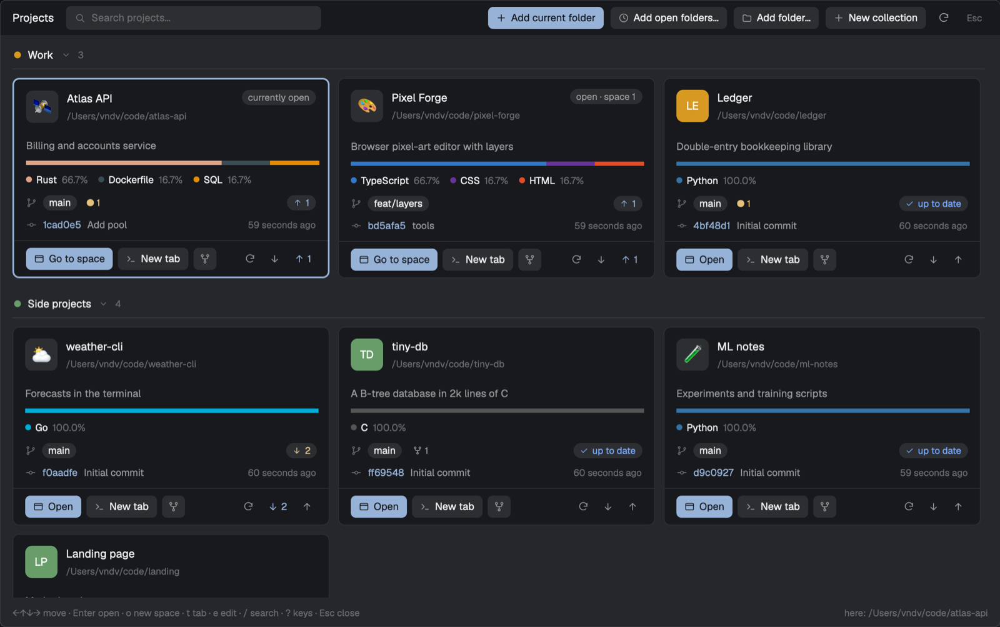

# Project Tiles for Herdr.app

A tile dashboard of your projects for [Herdr.app](https://herdr.dev), modelled on
[Project Tiles for VS Code](https://github.com/InvisibleF0x/project-tiles). A plain-JS mod,
listed in the [Herdr mods gallery](https://herdr.dev/mods): nothing to build.

Each tile shows a logo (emoji or initials), path, description, language bar, git branch,
ahead/behind, changed files, worktrees and the last commit, plus live state from Herdr: where the
project is open, its agents (working, blocked, done), and offline or deleted folders. Projects can
be grouped into coloured collections, reordered and searched. Every key and command is in
[`herdr-app/RECIPE.md`](herdr-app/RECIPE.md).

## Install

Ask Herdr's agent: *"Read ~/.config/herdr-app/AGENTS.md, then add this mod:
herdr.dev/mods/vndv/herdr-project-tiles"*. Or by hand:

    git clone https://github.com/vndv/herdr-project-tiles
    cp -R herdr-project-tiles/herdr-app/mods/project-tiles ~/.config/herdr-app/mods/
    herdr-app check ~/.config/herdr-app/mods/project-tiles

Then bind a key in `~/.config/herdr-app/keys.json`: `"cmd-alt-p": "mod.open:project-tiles"`.
To show it as a tab, put the mod in a layout block with `"props": {"embedded": true}`.

Needs `git` and `perl` on the machine the projects live on (git 2.38+ for the language bar from
tracked files; older git falls back to a folder scan).

## What it runs

- **git**, read-only (`--no-optional-locks`, hooks and fsmonitor off), plus a background
  `fetch` for repos with an upstream (20 s limit, `"fetch_remote": false` turns it off) and
  `fetch` / `pull --ff-only` / `push` on request. These use your own git config and SSH setup.
- **perl**, as a timeout guard: it kills git and its `ssh` child together at the deadline.
  Without perl, git runs directly and a hung `ssh` may outlive the timeout.
- **sh, find, wc** for folder checks; **open** and **mkdir** on this computer only.

No network besides git. A project with `"machine"` (a herdr-core machine, `hc machine ls`) has
these commands run on that machine.

## Files

- `~/.config/herdr/plugins/config/vndv.project-tiles/projects.json`: the catalog, same shape
  as the VS Code extension. Reloaded on change; edits are written only if the file is unchanged
  since it was read.
- `settings.json` next to it: columns, tile size, what to show, fetch and cache timings, open
  mode, ignored folders.
- `~/.config/herdr-app/data/project-tiles/metadata-cache.json`: the git and language cache.

## Development

    npm ci
    npm run ci            # static checks + test/model.test.mjs
    herdr-app check herdr-app/mods/project-tiles

`model.js` holds the logic and has no Herdr imports, so tests run it under Node against temp git
repositories, with no network and your git config ignored. CI runs `npm run ci` on Linux and
macOS, plus a [Skylos](https://github.com/duriantaco/skylos) gate.

Releases use [Changesets](https://github.com/changesets/changesets): add one with
`npx changeset`. Merging the "chore: version packages" PR tags `v<version>` and publishes a
GitHub release with the mod as `project-tiles-<version>.zip`.

The former Rust backend and herdr TUI plugin are in the git history (last at `2bdad21`).

## License

MIT, see [LICENSE](LICENSE).
