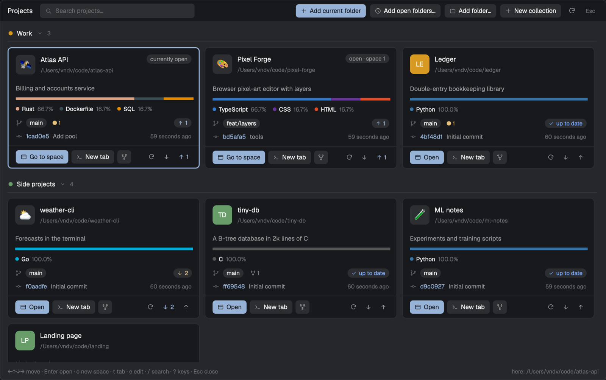

# Project Tiles

A dashboard of your projects as tiles, opened as a dialog over the window (`cmd-alt-p`). Each
tile shows the project's logo (emoji or initials), name, path, description, a language bar and
its git state: branch, ahead/behind, changed files, last commit. Tiles are grouped into
collapsible coloured collections. It marks which projects are open in a space and where you
are, counts agents working, blocked and done in each project, and opens a project in one keypress.
It is a port of [Project Tiles for VS Code](https://github.com/InvisibleF0x/project-tiles) and shares its catalog format.

## What you see

- **Header**, 42px, on the dialog background with a bottom border:
  - "Projects" in 13px semibold;
  - a 300px search field (28px high, rounded 6, raised fill);
  - buttons on the right: Add current folder (accent fill), Add open folders…, Add folder…, New collection;
  - a refresh icon and "Esc".
- **Body** with a 14px side padding: collections top to bottom. Each one has:
  - a header row: a colour dot, its name, a chevron and a project count;
  - a grid of tiles under the header, 3 columns by default. Columns drop as the width falls below 320px per tile (250px compact). Gap 10px.
- **Tile**, rounded 8, raised card. From top to bottom:
  - **Head:**
    - a 38px logo square (30px compact, rounded 8): an emoji, or initials on the project colour;
    - the name, 13px semibold, with the path under it in muted text;
    - a pill on the right: `currently open` (the focused terminal is in this project) or `open · space N`.
  - **Description**, one line.
  - **Language bar:**
    - a 5px bar of language shares, in GitHub linguist colours;
    - a legend with the top three languages and their percentages.
  - **Git line:**
    - a branch pill (rounded 9, 18px high);
    - `● N` changed files in the working colour;
    - a worktree count (`⑂ N`) when the repo has linked worktrees;
    - on the right: `↑N` ahead (blue), `↓N` behind (orange), `✓ up to date` (green), or `no fetch` (dim) when the remote was never fetched.
  - **Commit line:** the short hash in the link colour, the subject, and "N minutes ago".
  - **Footer**, on a border line:
    - `Open`, or `Go to space` when it is already open (accent);
    - `New tab`;
    - a worktree button;
    - on the right, icon buttons: gitview (only when herdr-gitview is installed), fetch, pull with the behind count, push with the ahead count.
  - Buttons drop their labels on narrow tiles.
- **Status line** at the bottom, 11px muted:
  - on the left, a key hint;
  - on the right, the last message (git errors in red), or `here: <path>`.
- **Selection:** the selected tile gets a 2px accent border; a selected collection header gets an accent underline.
- **Unavailable projects:**
  - an unmounted volume (`/Volumes/...`) is shown dim and dashed (offline);
  - a deleted folder is shown in red.

## How it behaves

- **Agents:** counts come live from `panes()`:
  - working shows yellow `●N`;
  - blocked shows red `●N`;
  - done shows teal `●N`;
  - idle is not shown.
- **Keys:**
  - Arrows or `hjkl` move; mouse click selects; a double click opens.
  - **Opening:**
    - `Enter` selects the space showing the project (`space.select`), or creates one (`space.new {folder, name}`), then closes the dialog;
    - `o` always opens a new space;
    - `t` opens a new tab in the current space (`tab.new`).
  - **Worktrees:** `w` opens Herdr's worktree dialog for a new git worktree; `W` opens an existing one.
  - `g` opens gitview for the project, when herdr-gitview is installed.
  - **Search and adding:**
    - `/` searches name, path, description, languages and branch;
    - `a` adds the focused terminal's folder (its git root);
    - `A` adds a folder by path;
    - `I` imports open folders and the VS Code Project Tiles catalog.
  - **Catalog edits:**
    - `e` edits a project (name, path, description, colour, emoji, languages, collection) in a form;
    - `d` removes it from the list (the folder is not touched);
    - `m` moves it to a collection;
    - `n` creates a new collection;
    - `J`/`K` reorder;
    - `Space` collapses a collection.
  - **Git:**
    - `f`, `p`, `P` run git fetch, pull `--ff-only` and push in the background (errors become Herdr toasts);
    - `r`/`R` refresh one or all projects.
  - **Other:**
    - `O` reveals the project in Finder;
    - `c` switches between compact and normal tiles;
    - `E` edits `projects.json` in `$EDITOR` in a new tab;
    - `?` shows help;
    - `Esc` closes.
- **Clicks:**
  - the branch pill opens the branch on GitLab, GitHub or Bitbucket (the repository when the branch is not pushed under its own name);
  - the commit hash opens the commit;
  - the worktree count opens the worktree picker;
  - `● N` opens gitview.
- **Background refresh:**
  - git state refreshes on open, from cache first, then a local scan, then `git fetch` for repos with an upstream;
  - it refreshes again after `metadata_cache_minutes` (10) while the dialog stays open;
  - catalog edits made elsewhere show up within 2s.

## Built from

- `mods/project-tiles/`:
  - `mod.json`: `place: "none"`, `focusable: true`, overlay dialog 0.92 × 0.9.
  - `main.js`: the view.
  - `model.js`: pure logic (rows, navigation, presence, colours, git pills), with node tests in the repo.
  - `icons/*.svg`: its own icons.
- **herdr API:**
  - calls: `spaces()`, `panes()`, `focused()`, `theme()`, `exec()`, `readTextFile`/`writeTextFile` (written with the expected-text check), `openOverlay`/`closeOverlay`, `notify`, `pickFolder`, `nextCommand()`;
  - commands: `space.select`, `space.new`, `tab.new`, `mod.open` (`worktree`, `gitview-tab`).
- **Programs:** it runs the `project-tiles` binary, found on PATH, `~/.cargo/bin`, `~/.local/bin` or Homebrew, or set with the `bin` prop. Install it with
  `cargo install --locked --git https://github.com/vndv/herdr-project-tiles`. The binary:
  - prints JSON: `app paths | meta | git | resolve | import`;
  - runs `git` in project folders, read-only and without hooks for status; fetch, pull and push only when asked;
  - never prompts for ssh passwords and caches results.
  `open` is used for links and Finder.
- **Files outside its folder:**
  - `~/.config/herdr/plugins/config/vndv.project-tiles/projects.json`: the catalog. It is shared with the herdr TUI plugin from the same repo and uses the VS Code Project Tiles format.
  - `settings.json` next to the catalog.
  - `~/.local/state/herdr/plugins/vndv.project-tiles/metadata-cache.json`.
- **Optional:** it can be embedded as a layout tab with `props {embedded: true}`. It then never takes focus on start; a tab bar mod sends it `run("project-tiles.focus")`.

## Watch out

- Without the binary the dialog only shows the install hint. Check `project-tiles app paths` in a terminal.
- `exec` gets the login environment. A `cargo install` into `~/.cargo/bin` works even when that directory is not on the GUI PATH, because the mod also tries the full path.
- Never take focus in `render`. Focus comes from `nextCommand()` ("focus") and from handlers.
- Button clicks must `stop_propagation()`, or a double click on Fetch also opens the project.
- Scroll the list to the selected row only when the selection moves, or live updates jump the view.
- Paths compare case-insensitively, with `/private/tmp` equal to `/tmp` (macOS). Linked worktrees count for their main project.
- Tested with 8–30 projects. The grid is not virtualised.

## Done when

- `herdr-app check mods/project-tiles` passes, and `cmd-alt-p` opens the dialog with your projects grouped by collection.
- A project open in a space shows `open · space N`; its `Go to space` (or `Enter`) shows that space and closes the dialog.
- A repo with local commits shows `↑N`; after `f` on a repo with new upstream commits, it shows `↓N`.
- `/` filters by branch name; `e` changes a name, and the change is in `projects.json`.
- Clicking a GitHub repo's branch pill opens `https://github.com/<owner>/<repo>/tree/<branch>`.
